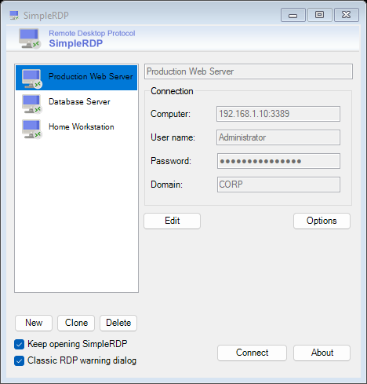

# SimpleRDP

A lightweight, portable, and streamlined Remote Desktop (`mstsc.exe`) connection manager for Windows.



## Overview

By default, Windows Remote Desktop Connection (`mstsc.exe`) binds saved credentials to a single Windows machine and lacks a convenient profile list. **SimpleRDP** wraps the native Windows RDP client in a clean, WinSCP/HeidiSQL-inspired interface while storing connection profiles and encrypted credentials in a portable folder that can be backed up or moved between PCs.

## Features

- **100% Portable**: Self-contained single executable (`SimpleRDP.exe`) storing all settings in `config.json` and `.rdp` files in `rdp-files/`.
- **Backup-Ready Saved Passwords**: Easily migrate or back up your saved connections and passwords across Windows machines by copying the application folder.
- **Native RDP Experience**: Launches Windows' built-in `mstsc.exe` for full compatibility, performance, and multi-monitor/redirection support.
- **Quick Profile Cloning**: Duplicate existing connection profiles (including custom `.rdp` settings) with one click via the **Clone** button.
- **Persistent Window Layout**: Automatically remembers your preferred window height on exit.
- **Classic RDP Warning Dialog Toggle**: Easily switch the Windows RDP redirection warning dialog policy (`RedirectionWarningDialogVersion = 1` under `HKLM\SOFTWARE\Policies\Microsoft\Windows NT\Terminal Services\Client`).

---

## Short Manual

### 1. Creating & Editing a Connection
1. Click **New** below the profile list (or select an existing profile and click **Edit**).
2. Enter a display **Name** at the top right, along with the **Computer** (`hostname` or `IP:port`), **User name**, **Password**, and optional **Domain**.
3. Click **Save** to store the profile.

### 2. Cloning a Connection
1. Select an existing profile from the list on the left.
2. Click **Clone** to create a copy of the profile (including any advanced `.rdp` settings) and immediately edit its details.
3. Adjust the name or host and click **Save**.

### 3. Connecting to a Remote Desktop
- Double-click a profile in the list, or select it and click **Connect**.
- Check **Keep opening SimpleRDP** if you want the manager window to stay open after the RDP session closes.

### 4. Configuring Advanced RDP Settings (Resolution, Drives, Audio, etc.)
1. Select a saved profile and click **Options**.
2. The native Windows Remote Desktop Connection configuration dialog will open for that profile.
3. Configure your display resolution, local resources, or experience settings, then click **Save** inside the native RDP dialog (do not click *Connect* there) and close it.

### 5. Classic RDP Warning Dialog Option
- Toggle **Classic RDP warning dialog** at the bottom-left to set or remove the `RedirectionWarningDialogVersion` (`DWORD = 1`) registry policy in `HKEY_LOCAL_MACHINE\SOFTWARE\Policies\Microsoft\Windows NT\Terminal Services\Client` (prompts for Administrator permission via UAC if needed).

### 6. Backing Up Your Connections
- Copy the `SimpleRDP.exe` binary along with `config.json` and the `rdp-files/` directory to your backup location or another PC.

---

## Building from Source

- **Framework**: .NET Framework 4.7.2 (Windows Forms)
- **Build**:
  ```powershell
  msbuild SimpleRDP.sln /t:Restore /p:RestorePackagesConfig=true
  msbuild SimpleRDP.sln /p:Configuration=Release
  ```
  The standalone executable will be generated at `bin\Release\SimpleRDP.exe`.

## Credits & License

- Modified 2026 by Alex under the MIT License.
- Originally based on RDP Portal by Louis Lam (MIT License).
- Computer icons created by Freepik - Flaticon.
